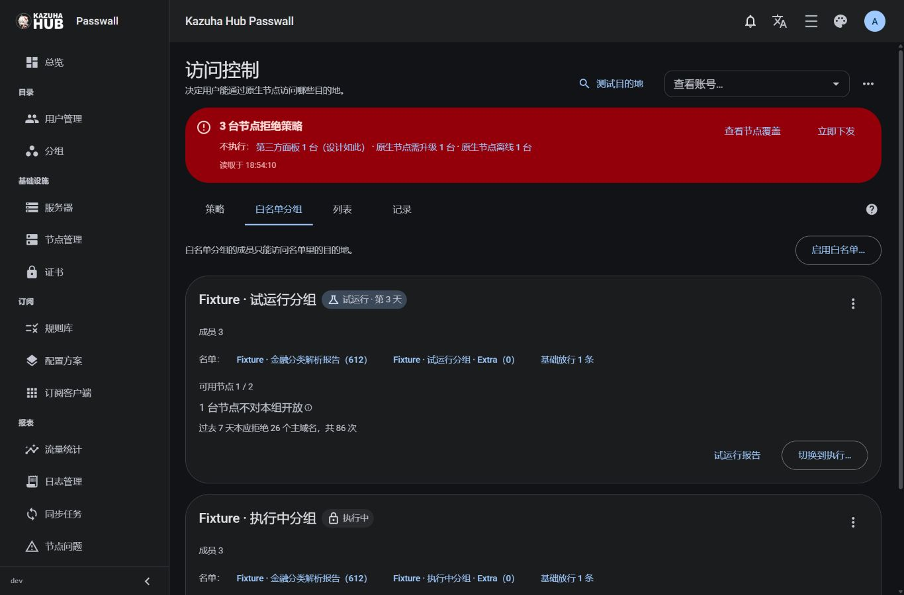
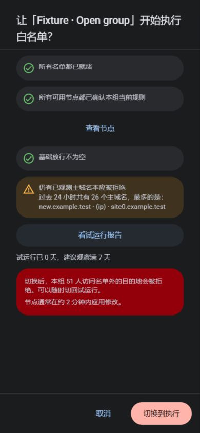

# 白名单工作区验证记录

实现提交：`6e50dde2b5073d9243ee9db7c60e5bad14c323ee`，草稿 PR [#283](https://github.com/KazuhaHub/Passwall-Sub-Panel/pull/283)，依赖 #282。

本记录覆盖 S8 页面挂载、S9–S11 向导/报告/模式切换、S17 分组摘要及导航。
后端管理与就绪状态沿用上一轮实现；真实节点执行效果仍需单独验收。

## 页面实测

2026-10-10 在隔离的本地面板与开发专用 `allowlist` 合成场景中验证：

- 1366×900 桌面概览显示试运行与执行分组、实际名单条数和节点排除原因。
- 390×844 手机布局没有横向溢出；模式确认以全屏显示影响人数、节点回执与警告。
- 启用向导从开放分组选择名单，经节点预览进入试运行报告；成功反馈与节点确认分开。
- 报告显示全部 26 个站点，包括 IP 聚合项；批量加入两个站点后，未处理数变为 24，
  对应条目提示“已加入 · 下次下发后生效”。
- 模式确认重新读取就绪状态后允许提交；合成场景切换后展示执行中的拒绝记录入口。
- `/admin/groups?edit=12&dtab=destination` 自动打开目的地摘要并消费参数；摘要按钮
  跳转到该组启用入口，取消后清除 `al_enable`，不会重复打开向导。
- 排除节点提示可以打开并通过 Escape 关闭；浏览器未捕获控制台错误。

## 自动检查与边界

逐块测试覆盖首次启用的单次 CAS、自带列表保留、冲突重读、就绪门槛、完整报告与
分页、去重追加、IP 项、读取失败隐藏缓存、未保存修改确认，以及写入中离页后失败
仍有全局提示。Go 全量测试、vet、前后端构建、lint、166 项部署脚本测试和生产浏览器
冒烟通过；最终完整前端测试与当前提交 CI 的结果记录在 PR 中。

生产构建禁止夹具入口和内容，冒烟检查覆盖该边界。上述截图与操作使用合成数据，
不能证明原生节点上的候选下发、内核执行或采集完整性。

当前 Windows 会话执行 Hyper-V `Get-VM` 返回权限不足；真实节点虚拟机验收、负载、
升级与混合版本等后续门槛尚未完成。没有修改系统权限或安全设置，也未进行合并或发布。
